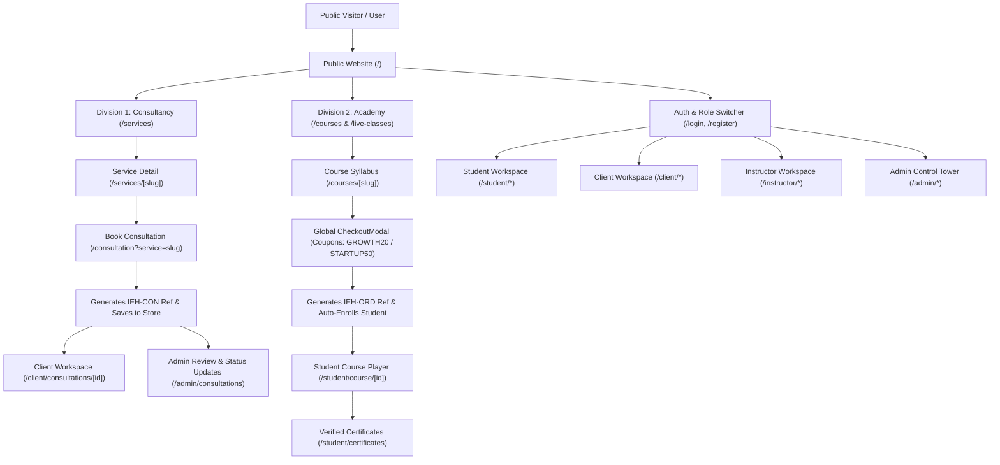

# Internet Entrepreneurs Hub (IEH)

**Internet Entrepreneurs Hub (IEH)** is a full-featured business consulting and online learning platform built with **Next.js 16 (App Router)**, **React 19**, **TypeScript**, and **Tailwind CSS v4**.

The platform operates across two integrated divisions:
- **Division 1 — Business Consultancy:** Strategic advisory services, startup validation, digital transformation, e-commerce architecture, and 1-on-1 corporate consultation booking and tracking.
- **Division 2 — IEH Academy:** Structured online courses with interactive lesson completion tracking, live broadcast classes (YouTube Live & Facebook Live), verified certificates, and promotional checkout flows.

**Executive Leadership:**
- **Md. Roman Alom** — Founder & CEO
- **S M Alif Ahmmed** — Co-Founder & CTO

---

## Tech Stack

| Layer | Technology |
| :--- | :--- |
| **Framework** | Next.js `16.4.6` (App Router, Turbopack, `cacheComponents`, `partialPrefetching`) |
| **UI Library** | React `19.3.0` |
| **Language** | TypeScript `5` |
| **Styling** | Tailwind CSS `4.3.3` (`@tailwindcss/turbopack`, strict **Light Mode Only** design system) |
| **Icons & Charts** | `lucide-react`, `recharts`, `clsx`, `tailwind-merge` |
| **Fonts** | `Inter` (body) & `Plus Jakarta Sans` (headings) via `next/font/google` |
| **State & Persistence** | Client-side React Context store (`src/lib/store.tsx`) hydrated with `localStorage` |
| **Linting** | ESLint `9` (`eslint-config-next`) |
| **Package Manager** | `pnpm` (`11.20.0`) |

---

## Project Flow Overview

The application is powered by a unified client-side reactive store (`AppProvider` in `src/lib/store.tsx`) mounted in `src/app/layout.tsx`, seeded from `src/lib/mock-data/index.ts`, and persisted across sessions in browser `localStorage` (under `ieh_*` keys). Global overlays (`NotificationToast` and `CheckoutModal`) are mounted at the root layout so actions across any page produce immediate visual feedback.



### Core Functional Flows

1. **Academy Enrollment & Learning Flow**
   - Visitors browse and filter courses at `/courses` and inspect full curricula at `/courses/[slug]`.
   - Clicking **Enroll** triggers the global `CheckoutModal`, which validates promo codes (`GROWTH20`, `STARTUP50`), creates a simulated order (`IEH-ORD-XXXXXX`), and automatically enrolls the active user.
   - Students access their enrolled courses in `/student/my-courses`, watch lessons and toggle completion milestones in `/student/course/[id]`, view invoices in `/student/orders`, and download certificates in `/student/certificates`.

2. **Business Consultancy Booking & Lifecycle Flow**
   - Prospective clients explore advisory offerings at `/services` and review methodologies/FAQs at `/services/[slug]`.
   - Clicking **Book Consultation** navigates to `/consultation?service=<slug>`, pre-selecting the requested service.
   - Submitting generates a tracking reference (`IEH-CON-XXXXXX`), which appears immediately in the Client Dashboard (`/client/consultations` and `/client/consultations/[id]`) and in the Admin Consultation Desk (`/admin/consultations`) for status progression (`pending` → `under_review` → `confirmed` → `in_progress` → `completed`).

3. **Live Broadcasts & Support Ticketing Flow**
   - Instructors (`/instructor/live-classes`) and Admins (`/admin/live-classes`) schedule YouTube Live and Facebook Live sessions that propagate to `/live-classes` and `/student/live-classes`.
   - Users submit support requests from `/support` or their role dashboards (`IEH-TKT-XXXXXX`), and staff respond or update ticket statuses in real time from `/admin/support`.

4. **Multi-Role Workspace & Demo Switching Flow**
   - All authenticated workspaces (`student`, `client`, `instructor`, `admin`) share a unified responsive shell (`DashboardLayout`) with role-specific sidebar navigation and a quick demo role switcher.
   - Users can switch roles anytime via `/login`, the top Navbar profile menu, or the Dashboard header bar without reloading data.

---

## Project Structure

```text
internet-entrepreneurs-hub/
├── .agents/
│   └── rules/                      # Modular AI/engineering conventions (Next 16, routing, SEO, TS, styling)
├── docs/                           # Persistent architecture & status documentation
│   ├── API_ARCHITECTURE.md
│   ├── DECISIONS.md
│   ├── DEVELOPMENT_HISTORY.md
│   ├── FRONTEND_ARCHITECTURE.md
│   ├── PROJECT_CONTEXT.md
│   ├── PROJECT_STATUS.md
│   └── SEO_ARCHITECTURE.md
├── public/                         # Static public assets
├── src/
│   ├── app/                        # Next.js App Router (61 feature routes + fallbacks & SEO)
│   │   ├── layout.tsx              # Root layout (Fonts, AppProvider, NotificationToast, CheckoutModal)
│   │   ├── globals.css             # Tailwind v4 imports & strict Light Mode design tokens
│   │   ├── page.tsx                # Homepage (/)
│   │   ├── error.tsx               # Global client error boundary
│   │   ├── loading.tsx             # Global loading skeleton
│   │   ├── not-found.tsx           # Branded 404 page
│   │   ├── robots.ts               # Search crawler rules (/robots.txt)
│   │   ├── sitemap.ts              # Dynamic XML sitemap (/sitemap.xml)
│   │   ├── about/                  # Company overview & leadership
│   │   ├── services/               # Consultancy catalog & [slug] detail pages
│   │   ├── consultation/           # Consultation booking form (Suspense-wrapped)
│   │   ├── courses/                # Academy catalog & [slug] syllabus pages
│   │   ├── instructors/            # Faculty directory
│   │   ├── live-classes/           # Public live broadcast schedule
│   │   ├── contact/                # Contact & corporate inquiries
│   │   ├── faq/                    # Categorized FAQ explorer
│   │   ├── support/                # Public Help Center & ticket submission
│   │   ├── terms-and-conditions/   # Legal policy
│   │   ├── privacy-policy/         # Legal policy
│   │   ├── refund-policy/          # Legal policy
│   │   ├── cookie-policy/          # Legal policy
│   │   ├── login/                  # Authentication & 1-click demo role login
│   │   ├── register/               # Student / Client account registration
│   │   ├── forgot-password/        # Password recovery simulation
│   │   ├── reset-password/         # Password reset simulation
│   │   ├── verify-email/           # Account activation simulation
│   │   ├── student/                # Student Workspace (9 routes)
│   │   ├── client/                 # Client Workspace (6 routes)
│   │   ├── instructor/             # Instructor Workspace (6 routes)
│   │   └── admin/                  # Admin Control Tower (19 routes)
│   ├── components/
│   │   ├── checkout/
│   │   │   └── CheckoutModal.tsx   # Course enrollment checkout with promo code validation
│   │   ├── layout/
│   │   │   ├── AnnouncementBar.tsx # Top announcement banner
│   │   │   ├── DashboardLayout.tsx # Unified sidebar + header shell for all 4 dashboard roles
│   │   │   ├── Footer.tsx          # Corporate footer & legal links
│   │   │   └── Navbar.tsx          # Sticky single-line navigation header with short IEH logo
│   │   └── ui/
│   │       └── NotificationToast.tsx # Global transient status toast
│   ├── lib/
│   │   ├── mock-data/
│   │   │   └── index.ts            # Seed data (users, services, courses, classes, orders, coupons, FAQs)
│   │   ├── store.tsx               # AppProvider & useApp() reactive state + localStorage persistence
│   │   └── utils.ts                # cn(), currency/date formatters, reference ID generators
│   └── types/
│       └── index.ts                # Core TypeScript domain interfaces & union types
├── .env.example                    # Environment variable template
├── AGENTS.md                       # Repository navigation & engineering constraints
├── eslint.config.mjs               # ESLint v9 flat config
├── next.config.ts                  # Next.js 16 config (Turbopack, Cache Components, Unsplash images)
├── package.json                    # Project scripts & dependencies
├── pnpm-lock.yaml                  # Lockfile
└── tsconfig.json                   # TypeScript strict config & @/* path alias
```

### Route Map Summary (61 Application Routes)

| Module | Count | Routes |
| :--- | :---: | :--- |
| **Public Website** | 16 | `/`, `/about`, `/services`, `/services/[slug]`, `/consultation`, `/courses`, `/courses/[slug]`, `/instructors`, `/live-classes`, `/contact`, `/faq`, `/support`, `/terms-and-conditions`, `/privacy-policy`, `/refund-policy`, `/cookie-policy` |
| **Authentication** | 5 | `/login`, `/register`, `/forgot-password`, `/reset-password`, `/verify-email` |
| **Student Dashboard** | 9 | `/student/dashboard`, `/student/my-courses`, `/student/course/[id]`, `/student/live-classes`, `/student/orders`, `/student/certificates`, `/student/notifications`, `/student/profile`, `/student/support` |
| **Client Dashboard** | 6 | `/client/dashboard`, `/client/consultations`, `/client/consultations/[id]`, `/client/orders`, `/client/support`, `/client/profile` |
| **Instructor Dashboard** | 6 | `/instructor/dashboard`, `/instructor/courses`, `/instructor/students`, `/instructor/live-classes`, `/instructor/announcements`, `/instructor/profile` |
| **Admin Dashboard** | 19 | `/admin/dashboard`, `/admin/users`, `/admin/students`, `/admin/instructors`, `/admin/clients`, `/admin/courses`, `/admin/courses/create`, `/admin/categories`, `/admin/services`, `/admin/consultations`, `/admin/live-classes`, `/admin/orders`, `/admin/payments`, `/admin/coupons`, `/admin/support`, `/admin/announcements`, `/admin/reviews`, `/admin/reports`, `/admin/settings` |
| **Fallbacks & SEO** | 5 | `not-found.tsx`, `error.tsx`, `loading.tsx`, `/robots.txt`, `/sitemap.xml` |

---

## Demo Accounts & Test Codes

All authentication, checkout, and booking flows run as client-side demo simulations with zero real payment processing.

### Pre-Configured Demo Accounts
You can switch between roles instantly on `/login` or from the header dropdown:

| Role | Name | Email | Workspace |
| :--- | :--- | :--- | :--- |
| **Admin (Founder & CEO)** | Md. Roman Alom | `admin@ieh.com` | `/admin/dashboard` |
| **Admin (Co-Founder & CTO)** | S M Alif Ahmmed | `cto@ieh.com` | `/admin/dashboard` |
| **Student** | Sarah Jenkins | `student@ieh.com` | `/student/dashboard` |
| **Client** | David Miller | `client@ieh.com` | `/client/dashboard` |
| **Instructor** | Dr. Marcus Vance | `instructor@ieh.com` | `/instructor/dashboard` |

### Demo Checkout Promo Codes
- `GROWTH20` — **20% off** course enrollment
- `STARTUP50` — **$50 fixed discount** on course enrollment

---

## Getting Started & Run Commands

### Prerequisites
- **Node.js** `20.x` or later
- **pnpm** `11.x` (recommended, specified in `package.json` `packageManager` field)

### 1. Install Dependencies
```bash
pnpm install
```

### 2. Configure Environment Variables (Optional)
Copy `.env.example` to `.env.local` if you want to customize site URLs:
```bash
cp .env.example .env.local
```
Default values in `.env.example`:
```env
NEXT_PUBLIC_SITE_URL=http://localhost:3000
NEXT_PUBLIC_API_URL=http://localhost:3000/api
```

### 3. Run Development Server
Starts Next.js 16 with Turbopack on `http://localhost:3000`:
```bash
pnpm dev
```

### 4. Build for Production
Compiles all 61 routes, runs TypeScript verification, and generates static/PPR bundles:
```bash
pnpm build
```

### 5. Run Production Server
Serves the compiled production build locally on `http://localhost:3000` (run `pnpm build` first):
```bash
pnpm start
```

### 6. Run Linter
Runs ESLint across the entire repository:
```bash
pnpm lint
```

> **Note:** If you prefer `npm` over `pnpm`, replace `pnpm` with `npm run` (e.g., `npm install`, `npm run dev`, `npm run build`, `npm run start`, `npm run lint`).

---

## Additional Documentation

For architectural standards, SEO rules, and project history, see:
- [`AGENTS.md`](./AGENTS.md) — Engineering constraints and quick navigation
- [`docs/PROJECT_STATUS.md`](./docs/PROJECT_STATUS.md) — Complete feature and route completion checklist
- [`docs/FRONTEND_ARCHITECTURE.md`](./docs/FRONTEND_ARCHITECTURE.md) — Component and state architecture
- [`docs/SEO_ARCHITECTURE.md`](./docs/SEO_ARCHITECTURE.md) — Metadata, sitemap, and crawler configuration
- [`docs/DEVELOPMENT_HISTORY.md`](./docs/DEVELOPMENT_HISTORY.md) — Chronological development log
